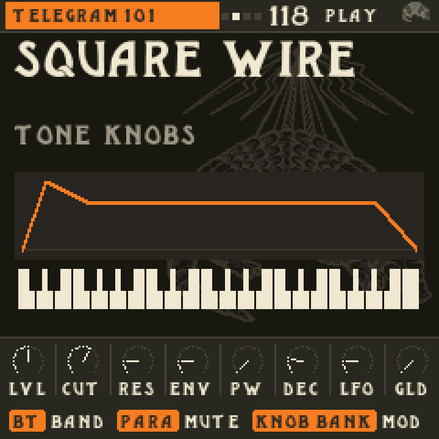
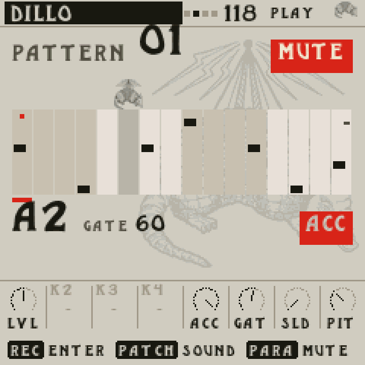
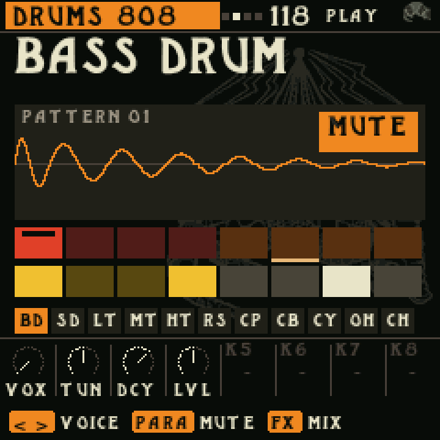
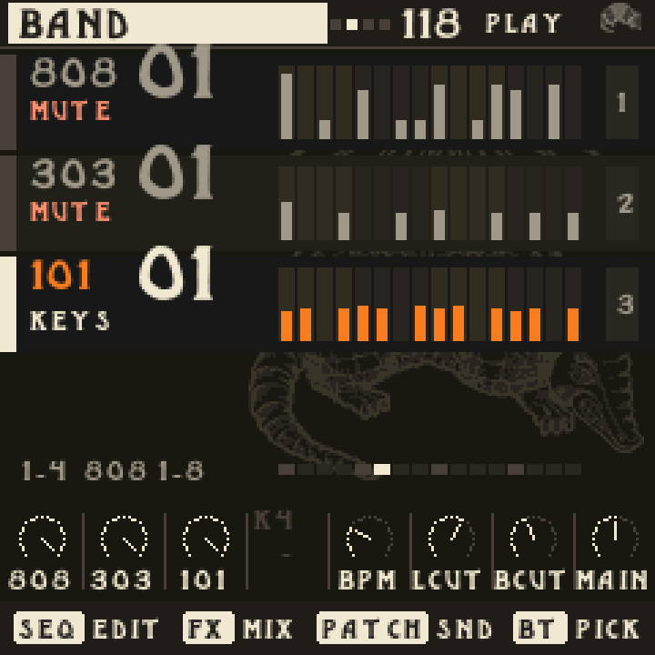

# Big Beat Studio BB–37

**Firmware for the M-VAVE SMK-37 Elite. The 101. The 303. On your Elite.**

BB–37 turns the SMK-37 Elite into Telegram, our take on the SH-101, and Dillo, our take on the TB-303, with an 808 to play against. 112 Telegram patches and 329 phrases. 106 Dillo sounds and 1,136 patterns. Pick one and play, or turn a knob and make it yours. No computer needed.

**Written for the Elite. Not ported to it.** Telegram’s 101 voice, every screen, the controls and the Band were built for this keyboard: its thirty-seven keys, its eight knobs, its sixteen pads. Nothing was squeezed on from another box. Dillo and the 808 share their sound engine with Big Beat Studio, which is why they sound like family.

**The 1982 factory sounds, as Roland charted them.** All forty sounds from the SH-101 owner’s manual, set from Roland’s own charts, Flute to Thunder. Plus eight patches readers sent to the magazines in the eighties.

**New to these two?** Roland's SH-101 (1982) was a small, affordable synth with one oscillator, one filter and a grip so you could wear it on stage, and it became a lead and bass voice of synth-pop, house and techno. The TB-303 Bass Line (1981) was built to play along with guitarists; hardly anyone wanted it until Chicago producers found secondhand ones, turned the knobs too far and made acid house.

[The Big Beat](https://thebigbeat.app/) · [Meet BB–37](https://thebigbeat.app/elite/) · [Install BB–37](https://thebigbeat.app/elite/install/)

|  |  |  |  |
| --- | --- | --- | --- |
| **Telegram** | **Dillo** | **808** | **Band** |

*Host renders of the firmware's own drawing code, not photographs of the hardware.*

## Inside the box

| | |
| --- | --- |
| **Telegram, our 101** | One oscillator with saw, pulse, sub and noise on a mixer, the way the original did it. A four-pole filter with real bite. Pulse width from the LFO or the envelope, gate and trigger modes, auto glide that only slides when you play legato, an arp and a 100-step sequencer. |
| **Dillo, our 303** | The saw and that odd square, the filter that sounds like nothing else, accent that hits harder the more you stack, and slide that glides into the next note. Two Devilfish extras: slide time and accent decay. |
| **808** | Sixteen sounds, synthesised live, to give the synths something to play against. |
| **Band** | Telegram, Dillo and 808 parts on the sixteen pads, each changing on the next bar. |

The Library holds every Telegram and Dillo sound from Big Beat Studio with the phrases to match, plus Band presets from the BB1 songs and eras. Spin K1 and the screen tells you what each one is and how to play it.

BB–37 is made to sit next to BB1. BB1 turns the FM-1 into two drum machines; BB–37 is where the 101 and the 303 live, on proper keys.

## Get it

[Install BB–37](https://thebigbeat.app/elite/install/). Connect your Elite with a USB data cable to a Windows, macOS or Linux computer and open the installer. It backs up your unit, checks every step and installs BB–37. No Terminal, nothing to set up first, and the backup it keeps is your way back to the factory firmware.

**SMK-37 Elite only.** Not for the FM-1, SMK-37 Pro or SMK-37 MKE.

## Build it yourself

[BUILDING.md](BUILDING.md) has the exact build command and pinned inputs; the rebuilt package matches the release byte for byte. [TESTING.md](TESTING.md) lists the host checks:

```sh
make check check-101 check-dillo check-808 check-one-808
```

[PROVENANCE.md](PROVENANCE.md) records the build hashes. [SHA256SUMS](SHA256SUMS) covers the packages and generated banks.

## The small print

BB–37 is free software under the GNU GPL v3; components carrying other notices keep their own terms. See [LICENSE](LICENSE), [THIRD_PARTY.md](THIRD_PARTY.md) and [ACID-PARTS-PERMISSION.md](ACID-PARTS-PERMISSION.md). Screen type: Picnic by Taylor Rushing.

M-VAVE, SMK-37, Roland, SH-101, TB-303 and TR-808 are trademarks of their respective owners. BB–37 is an independent project from The Big Beat, not affiliated with or endorsed by them. No warranty: you install it at your own risk.

From the people behind [Drum Machines Have No Soul](https://drummachineshavenosoul.com/).
