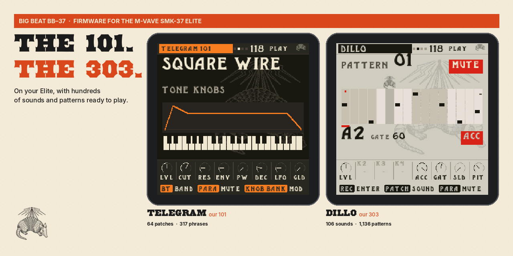

# BB-37

**The 101. The 303. On your SMK-37.**

BB-37 is firmware for the M-VAVE SMK-37 Pro, SMK-37 Elite and MKE-P37. It brings Telegram, a hands-on SH-101-inspired synth, Dillo, a TB-303-inspired bass synth, and an 808 into one performance instrument.

## Install

Open the [BB-37 installer](https://thebigbeat.app/elite/install/) in the latest Chrome or Edge. Connect your SMK-37 by USB, click **Install BB-37**, and keep it connected until it restarts.

The installer identifies the connected model and selects the matching package.

## Play

Choose sounds and patterns in the Library, shape them with the knobs, then use Band to cue Telegram, Dillo and drums together.

## Support

Open a [support issue](https://github.com/TexasRADIO/smk37-elite-firmware/issues) with the BB-37 version shown on your keyboard.

BB-37 is free software under the GNU GPL v3. Required third-party notices are included in this repository. M-VAVE, SMK-37, Roland, SH-101, TB-303 and TR-808 are trademarks of their respective owners. BB-37 is an independent project and is not affiliated with or endorsed by them.
