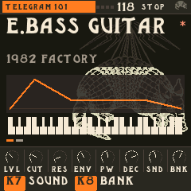

# BB-37

**The 101. The 303. On your SMK-37.**

BB-37 is firmware for the M-VAVE SMK-37 Pro, SMK-37 Elite and MKE-P37. It brings Telegram, a hands-on SH-101-inspired synth, Dillo, a TB-303-inspired bass synth, and an 808 into one performance instrument.

## Install

Open the [BB-37 installer](https://thebigbeat.app/elite/install/) in the latest Chrome or Edge. Connect your SMK-37 by USB, click **Install BB-37**, and keep it connected until it restarts.

The installer identifies the connected model and selects the matching package.

The packages use separate Hub-visible identities for the three hardware models: `FM-1_92370001` (Pro), `FM-1_92370002` (Elite) and `FM-1_92370003` (MKE-P37). The update loader retains each keyboard's model name and stock return route.

## Going back to M-VAVE's firmware

You can return to M-VAVE's own firmware at any time. BB-37 never writes the keyboard's calibration, Bluetooth pairing or boot area, and the keyboard keeps its own model identity (`SMK-37 Pro`, `SMK-37 Elite` or `MKE-P37`) throughout.

1. Download M-VAVE's firmware for your model, version 016 (`SMK-37 Pro_016`, `SMK-37 Elite_016` or `MKE-P37_016`), from [m-vave.com/download](https://www.m-vave.com/download).
2. Close other browser tabs and music software that use the keyboard's MIDI port. On Windows only one program can use it at a time.
3. With BB-37 running and the keyboard connected directly by USB, open the [BB-37 installer](https://thebigbeat.app/elite/install/#return), choose the file under **Going back to M-VAVE's firmware** and press **Return to M-VAVE firmware**. Keep the cable connected until the page says it is back.
4. At its first start, M-VAVE's firmware rebuilds its factory key, knob and fader mapping.

The installer accepts only M-VAVE's version 016 file for the connected model, and checks it against M-VAVE's unmodified file where that checksum is known. M-VAVE's own updater, M-UPGRADE, can install the same file. If a transfer is cut off, reconnect the keyboard and press the same button again with the same file.

Other SMK-37 firmware installers start only from M-VAVE's firmware (`<model>_016`). They do not recognise a keyboard running BB-37 (`<model>_<build>`) and stop before writing anything. Return to M-VAVE's firmware first, then use their installer.

## Hardware verification

Build 800 has been installed and run on a physical SMK-37 Elite. The same unit completed the return sequence Build 800 → factory Build 797 → Build 800. The Pro and MKE-P37 downloads have passed package and native verification; this statement does not claim physical testing on those two model labels. The return to M-VAVE's version 016 uses the same update exchange as an install; it has not yet been repeated on hardware by this project.

## Build

The repository contains the application source, pinned board source, generated public phrase data and the packaging tools used for Build 800. See [BUILDING.md](BUILDING.md) for the reproducible build command and toolchain requirement.

## Play

Choose sounds and patterns in the Library, shape them with the knobs, then use Band to cue Telegram, Dillo and drums together.

## Support

Open a [support issue](https://github.com/TexasRADIO/smk37-elite-firmware/issues) with the BB-37 version shown on your keyboard.

BB-37 is free software under the GNU GPL v3. Required third-party notices are included in this repository. M-VAVE, SMK-37, Roland, SH-101, TB-303 and TR-808 are trademarks of their respective owners. BB-37 is an independent project and is not affiliated with or endorsed by them.
