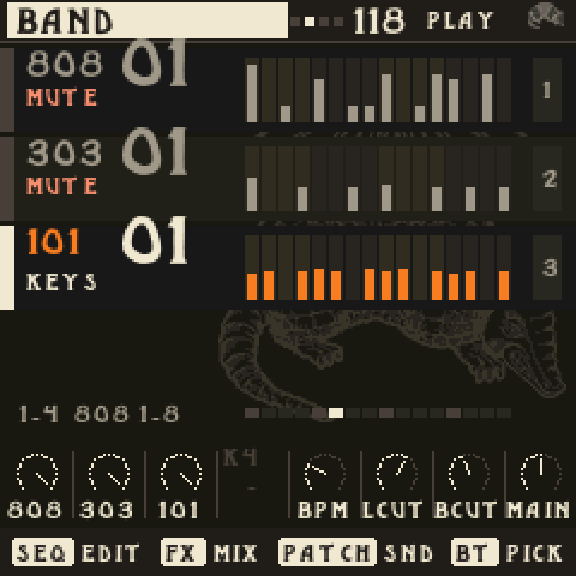

# Big Beat Studio BB-37

BB-37 brings Telegram, a 101-style synthesizer, Dillo, a 303-style bass
synthesizer, synthesized 808 drums and pad-launched Band arrangements to the
M-VAVE SMK-37 Elite.

[Product and guide](https://thebigbeat.app/elite/) ·
[Installer](https://thebigbeat.app/elite/install/)

## Elite build 826

This source corresponds to `BB-37-Elite-Build-826.fwsc`, package identity
`SMK-37 Elite_3737826`. It includes the shared Big Beat Editor foreground
adapter. The adapter exposes a bounded working-state snapshot, parameter
transactions, transport and session queries. It does not implement a complete
device-library transfer service.

This package targets the **SMK-37 Elite**. Do not install it on an FM-1,
SMK-37 Pro or MKE-P37. [Older model-specific packages](https://github.com/TexasRADIO/smk37-elite-firmware/releases/tag/v1.0.1) remain available.

This is an **application update for an Elite with matching 727 content already
provisioned**. The FWSC does not install the separate percussion banks on a
fresh device. The matching bank files and attribution are included with the
source under `assets/layer727/`.

## Build and source

See [BUILDING.md](BUILDING.md) for the frozen build command and generated inputs.
[PROVENANCE.json](PROVENANCE.json) binds the package, application, retained
loader, recovery stub, toolchain and source inputs.

Original firmware code is GPL-3.0-only. Third-party code and assets retain their
own terms; see [LICENSE](LICENSE), [THIRD_PARTY.md](THIRD_PARTY.md) and the
retained component notices. BB-37 is independent of M-VAVE and Roland.
